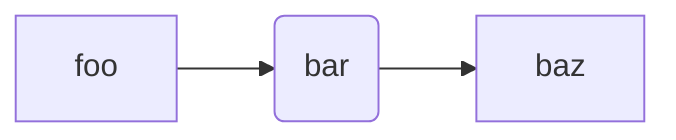

We are using python 3.14, here is how you reproduce our setup.

```bash
python3.14 -m venv ~/envs/nlp1-2026
source ~/envs/nlp1-2026/bin/activate
pip install --upgrade pip
pip install -r requirements.txt
jupyter lab
```

Each `part{N}` folder contains a tutorial notebook `tutorial.ipynb` and project instructions in `project.ipynb`.

## Alternatives

### Using `uv`

[`uv`](https://docs.astral.sh/uv/) is a fast, modern Python package manager that is quickly becoming the industry standard. It is fully compliant with Python standards, fully replaces `pip`, and interoperates well with PyTorch. To use it for this project:

1. [Install `uv`](https://docs.astral.sh/uv/getting-started/installation/)

2. Change the working directory:

    ```shell
    cd ./nlp1-student
    ```

3. Initialize the project

    ```shell
    uv init --bare .
    ```

    Notice the added file `pyproject.toml` file. This is where all metadata about this project/directory gets stored. You can read more about it [here](https://packaging.python.org/en/latest/guides/writing-pyproject-toml/).

    At the moment, it should look something like:

    ```toml
    [project]
    name = "nlp1-student"
    version = "0.1.0"
    requires-python = ">=3.14"
    dependencies = []
    ```

4. Install dependencies

    We're going to read the required dependencies from the provided `requirements.txt` file, and let `uv` handle installing the right versions

    ```shell
    uv add -r requirements.txt
    ```

    Note the new folder `.venv`. This is where all our dependencies live. Feel free to delete it once you're done, `uv` can quickly reconstruct it from its cache.

    In `pyproject.toml` the `dependencies` argument is now populated.

We can now use this virtual environment as we before

```shell
source .venv
```

Most modern IDEs (e.g., vscode or vscodium) should be able to recognize this virtual environment and load it for you.

### Using `vscode`

[Visual Studio Code (vscode)](https://code.visualstudio.com/) and its open-source twin [vscodium](https://vscodium.com/) are modern language agnostic text editors (read, IDE-lite). You can also use them for working with Jupyter or `.ipynb` notebooks. While these do not enjoy first-class support, the benefit of an IDE is that you can also access the terminal, edit regular `.py` files, and read all other files in the directory.

To use either for this project, we'll need to do a few extra steps.

1. Install and enable the [`Python`](https://open-vsx.org/vscode/item?itemName=ms-python.python) extension
2. Install and enable the [`Jupyter`](https://open-vsx.org/vscode/item?itemName=ms-toolsai.jupyter) extension
3. If necessary, install the `jupyter` package

    ```shell
    uv add jupyter 
    ```

4. When opening the notebook, use the 'Select kernel' dropdown, and select `.venv` (located as `./.venv/bin/python`)

You should now be able to read, edit and run the various `*.ipynb` notebooks in this directory

You can read more about the features vscode has for notebooks [here](https://code.visualstudio.com/docs/datascience/jupyter-notebooks).

#### Mermaid Diagrams

Some of the notebooks use [`mermaid`](https://mermaid.js.org/) diagrams. For example:



If these are not rendering automatically (i.e., you see text instead of a diagram), you might need to upgrade your vscode instance to at least version [1.121.0](https://code.visualstudio.com/updates/v1_121#_mermaid-diagrams-in-markdown-preview-and-notebooks). If this is not possible, you should also be able to replicate this effect by installing the [Markdown Preview Mermaid Support](https://marketplace.visualstudio.com/items?itemName=bierner.markdown-mermaid).

## Snellius

If you'd like to run your tutorial notebooks via Snellius, either on CPU or GPU nodes, you can follow the instructions found [here](https://docs.google.com/document/d/18Ql8Hv-ibAGCTBvqmPVSaXBNNBSl1mtnpT8tIyoRPZM/edit?usp=sharing).
